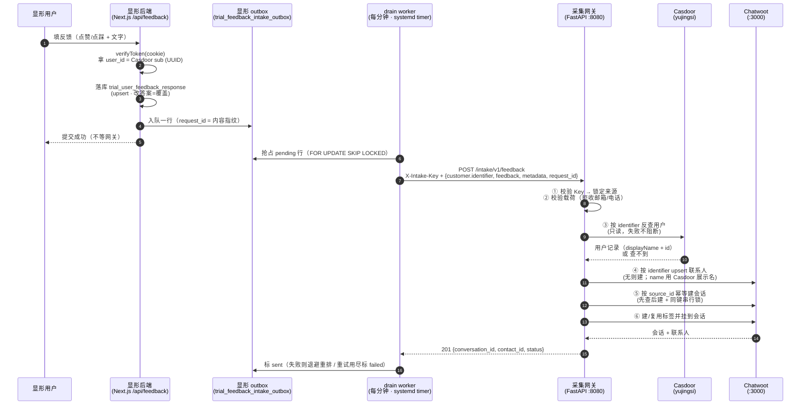

# 端到端流程：第三方 App 提交客户声音 → Chatwoot

> 以 **显形**（原 deepprep，仓库 `~/projects/Manifest/TaskAvatar`）为样板来源。
> 本文回答三个问题：
> 1. 显形用户提交反馈时，**到底提交什么**给 Chatwoot？
> 2. 网关收到后**做了什么**？
> 3. Chatwoot/网关**怎么据此从 Casdoor 查到该显形用户**？

---

## 0. 一句话总览

> 显形把 **Casdoor 的 `sub`（UUID）** 当作 `customer.identifier` 提交给采集网关；
> 网关拿这个标识去 Casdoor 的 `yujingsi` 组织**反查用户**，补上展示名、记下
> `casdoor_user_id`，然后落成一条 Chatwoot 会话 + 一个联系人。
> **邮箱、电话一步都不碰 —— 身份只存在 Casdoor 一份。**

```
显形用户 ──▶ 显形后端 ──▶ 采集网关 ──▶ Casdoor（只读反查）
                          │
                          └──────▶ Chatwoot（会话 + 联系人）
```

---

## 1. 四个角色，各管各的

| 角色 | 是什么 | 职责 | 不管什么 |
|---|---|---|---|
| **显形**（第三方 App） | Next.js 应用 | 采集用户反馈原文、知道"当前用户是谁" | 不知道 Chatwoot 的字段规则、不知道 Casdoor 的组织结构 |
| **采集网关** | 本仓 `gateway/`（FastAPI，:8080） | 鉴权、统一契约、补齐来源元数据、幂等、落库 | 不存身份信息、不做业务判断 |
| **Chatwoot** | :3000 | 存客户声音（会话 + 联系人 + 标签 + 属性） | **不存邮箱/电话** |
| **Casdoor** | 共享实例 `http://casdoor.test:9201`，组织 `yujingsi` | **用户身份的唯一真值源** | 不管反馈内容 |

> 关键设计：**上游不需要知道 Chatwoot 怎么存**。显形只管交出「反馈原文 + 用户标识」，
> 其余的来源系统、接收时间、反馈类型、标签、幂等键，全由网关补齐。

---

## 2. 全景时序



---

## 3. 步骤一：显形怎么知道"当前用户是谁"

显形的身份链路（`modules/identity/lib/server/casdoor-client.ts`）：

```
浏览器 cookie（trial_casdoor_token）
  └─▶ verifyToken()  jose 验签
        ├─ user_id  = payload.sub   ← Casdoor 用户主键，UUID，**全局唯一且永不变**
        └─ username = payload.name   ← Casdoor 用户名，**会变**
                                     （访客 guest_<uuid> → 升级注册后变真实用户名）
```

`/api/auth/me` 把这套对象直接吐给前端和业务侧：

```ts
// modules/auth/api/me/route.ts
return NextResponse.json({
  ok: true,
  user_id: user.user_id,   // ← sub，UUID
  username: user.username, // ← name
  type: user.type,         // 'normal-user'
  plan: user.plan,         // 'free' | 'pro'
  owner: user.owner,       // 'yujingsi'
  is_authenticated: true,
});
```

`AuthContext` 的注释写得很直白：

> 业务侧（waitait / vote / **feedback**）通过这个对象知道当前用户是谁。

### ⚠️ 为什么必须用 `user_id`（sub）而不是 `username`

| | `user_id` (sub) | `username` (name) |
|---|---|---|
| 稳定性 | Casdoor 主键，**永不变** | 访客是 `guest_<uuid>`，升级注册后变真实名 |
| 唯一性 | 全局唯一 | 组织内唯一，可能被回收 |
| 查 Casdoor | 走「组织用户列表」匹配（有 TTL 缓存） | 走 `get-user?id=组织/名称`，O(1) |

> 用 `username` 当身份键，同一个用户升级前后会被拆成**两个 Chatwoot 联系人**，
> 历史反馈与新反馈对不上。所以：**`customer.identifier` 一律传 `sub`。**

---

## 4. 步骤二：显形提交什么给网关

### 4.1 网关的契约（上游唯一要面对的东西）

```
POST http://<内网地址>:8080/intake/v1/feedback
Content-Type: application/json
X-Intake-Key: <该来源系统的 API Key>
```

```jsonc
{
  "source_system": "company_xianxing",   // 必填，必须与 Key 绑定的来源一致
  "request_id": "fb-...",                // 推荐 · 幂等键
  "customer": {
    "identifier": "f095c408-b92d-48a0-b4b0-a7027dc14987", // 必填 = Casdoor sub
    "name": "显形用户昵称",                // 可选，不传就用 Casdoor 的展示名
    "company": "某某公司",                 // 可选
    "city": "杭州",                        // 可选
    "extra": { "vip_level": "gold" }      // 可选，其余客户属性
  },
  "feedback": {
    "content": "导出报表经常卡住，麻烦优化一下。",  // 必填 · 客户原话
    "title": "导出卡住",                            // 可选
    "feedback_type": "complaint",                   // 可选 · 会成为标签
    "sentiment": "negative",                        // 可选
    "rating": 2,                                    // 可选
    "channel": "app",                               // 可选
    "occurred_at": "2026-10-28T10:12:00+08:00",    // 可选
    "extra": { "reproduce_steps": "..." }           // 可选
  },
  "metadata": {                                     // 可选 · 来源系统自定义
    "target_type": "nps_survey",
    "target_id": "nps-survey",
    "session_id": "sess-abc"
  }
}
```

> **没有 `email` / `phone_number` 字段。** 传了会被 **422 明确拒绝**（并指向 Casdoor），
> 而不是被静默吞掉 —— 免得上游以为「提交了就已经收下了」。

### 4.2 显形现有字段 → 网关载荷 的映射表

显形现在有两套「反馈」相关的通道，**别搞混**：

| 显形通道 | 是什么 | 要不要进 Chatwoot |
|---|---|---|
| `modules/feedback/api/route.ts` (`POST /api/feedback`) | **客户声音**：用户对某个对象的评价原文 | ✅ **这就是要接的** |
| `trackCompanionEvent()`（companion-analytics） | **行为埋点/漏斗事件**：`contact_id` 是漏斗点名（如 `nps-survey`） | ❌ 不进 Chatwoot |

映射表（显形 `FeedbackRequest` → 网关 `IntakeRequest`）：

| 显形字段 | 网关字段 | 说明 |
|---|---|---|
| `user_id` (Casdoor sub UUID) | `customer.identifier` | ★ **身份键**。网关会加来源前缀写成 `company_xianxing:<sub>` |
| — | `customer.name` | 显形可传 `username` 兜底；不传则由网关从 Casdoor 取 `displayName` |
| `free_text` | `feedback.content` | ⚠️ 必填，但显形允许为空 → 见 §4.3 落差 ② |
| `sentiment` (`like`/`dislike`) | `feedback.sentiment` | ⚠️ 词表不同 → 见 §4.3 落差 ① |
| `preset_reason` | `metadata.preset_reason` | 原因码/文案，无对应字段，进 metadata |
| `target_type` | `metadata.target_type` | 被反馈对象的类型 |
| `target_id` | `metadata.target_id` | 被反馈对象的 id |
| `contact_id` | `metadata.companion_contact_id` | ⚠️ **这不是联系方式**，是埋点漏斗点名（`nps-survey` 等） |
| `session_id` | `metadata.session_id` | |
| `created_at`（本地生成） | `feedback.occurred_at` | 反馈发生时间 |
| `id`（库行 id / 降级哈希） | ⚠️ **不能直接当 `request_id`** | upsert 改答案时行 id 不变 → 改答案会被幂等吞掉 → 见 §4.3 落差 ③ |
| — | `feedback.channel` | 固定 `"app"` 或 `"web"` |
| — | `feedback.feedback_type` | 建议用固定枚举（`complaint`/`suggestion`/…），中文文案走 `metadata` |

### 4.3 三个必须显形侧拍板的落差

**① `sentiment` 词表不一致**
显形是 `like` / `dislike`，网关文档写的是 `positive` / `neutral` / `negative`。
Chatwoot 侧 `sentiment` 属性建的是 `text` 类型，**网关不校验取值**，两边都能落库 ——
但混着存就没法筛选了。**建议在显形侧映射**：`like → positive`、`dislike → negative`，
NPS 分数（0-10）可另行派生 `neutral`。

**② `content` 必填 vs `free_text` 可空**
显形规定 `sentiment=dislike` 时 `free_text` 必填（≥5 字），但 `like` 时可以为空。
网关的 `feedback.content` 是必填（`min_length=1`），空字符串会 **422**。
显形侧需兜底，例如 `content = free_text || preset_reason || '[点赞] 用户未填写文字评价'`。

**③ `request_id` 必须是稳定幂等键 —— 且必须含内容**

> ⚠️ **2026-10-30 修订**：显形原设计用「反馈行 id」当 `request_id`，在 upsert 落库下**是错的**。
> 显形的落库是 `ON CONFLICT (user_id,kind,scope,target_type,target_id) DO UPDATE`
> → 一人·一目标·一类**只有一行**，改答案 = 覆盖同一行 → **行 id 不变**。
> 于是用户先打 3 分再改成 9 分 → 网关按 source_id 幂等命中 →
> **Chatwoot 里那条会话永远停在 3 分**，而显形库显示 9 分 → 客服看到的是**过期**情绪，
> 两边对不上账。
>
> 正确做法：**内容指纹**。
> ```ts
> request_id = `fb-${sha256(
>   [user_id, kind, scope, target_type, target_id, score, tier, free_text].join('|')
> ).slice(0, 24)}`
> ```
>
> | 情形 | 键 | 结果 |
> |---|---|---|
> | 同一份内容重复提交（重试） | 同键 | 幂等命中，**不重复建会话** |
> | 改答案（分数/原话变了） | 异键 | **新建会话**（客户改主意本身也是 VOC 信号） |
> | 不同用户提交相同文案 | 异键 | 两条独立会话（`user_id` 参与指纹） |
>
> ⚠️ 指纹**不含时间戳 / 随机数 / 行 id** —— 含了就等于没有幂等。
> 也不依赖显形是否落库成功 → 降级期同样成立（不需要两套 key 空间）。
>
> 实现：显形仓 `modules/feedback/lib/server/intake-outbox.ts` 的 `buildIntakeRequestId`。

**④（已定 · 2026-10-30）未登录用户不能反馈**

显形 2026-09-29 已取消游客模式，非 `normal-user` 一律 401。
显形侧已按此实现（`user_id` 由服务端从会话注入 → 未登录直接 401），
所以 `customer.identifier` 必填这件事在显形侧**天然成立**，不再需要匿名标识。

> **2026-10-30 另一处修订**：显形转 Chatwoot 的链路已从「进程内 fire-and-forget」
> 改为**显形侧 outbox + drain worker**（每分钟异步投递）。
> 显形**不再直接调本网关**，只是把「要投什么」记进队列行；
> 失败按退避重试，重试用尽标死信。详见显形仓 `docs/operations/chatwoot-intake.md`。

---

## 5. 步骤三：网关做了什么

`POST /intake/v1/feedback` 进来之后，按顺序：

| # | 动作 | 失败后果 |
|---|---|---|
| ① | **鉴权**：`X-Intake-Key` → sha256 → 匹配注册表；锁定该 Key 绑定的来源 | 401 / 403 |
| ② | **来源对齐**：载荷里的 `source_system` 必须与 Key 绑定的来源一致 | 422（防来源伪造） |
| ③ | **载荷校验**：Pydantic `extra="forbid"`；邮箱/电话**明确拒绝** | 422 |
| ④ | **Casdoor 反查**：拿 `customer.identifier` 查 `yujingsi` 组织 | **不阻断**，只补展示名 |
| ⑤ | **联系人 upsert**：按 `<来源>:<identifier>` 找 → 没有就建；<br/>`name` 用上游的，没有就用 Casdoor 的 `displayName` | 502 |
| ⑥ | **会话幂等**：按 `source_id` 先查后建，同 `source_id` 并发用锁串行 | 502 |
| ⑦ | **标签**：来源标签 + `feedback_type`（先 `POST /labels` 再挂） | — |

### 落库结果对照（实测）

请求（用显形的真实字段）：

```jsonc
{
  "source_system": "company_xianxing",
  "request_id": "xianxing-flow-probe-1",
  "customer": { "identifier": "f095c408-b92d-48a0-b4b0-a7027dc14987" },
  "feedback": {
    "content": "导出报表经常卡住，麻烦优化一下。",
    "feedback_type": "导出卡住",
    "sentiment": "negative",
    "channel": "app",
    "occurred_at": "2026-10-28T10:12:00+08:00"
  },
  "metadata": { "target_type": "nps_survey", "target_id": "nps-survey",
                "preset_reason": "功能不好用", "session_id": "sess-abc" }
}
```

**Chatwoot 里的联系人**（`contacts` 表实测值）：

| 字段 | 值 | 来源 |
|---|---|---|
| `identifier` | `company_xianxing:f095c408-b92d-48a0-b4b0-a7027dc14987` | 网关加了来源前缀 |
| `name` | `trial 本机测试账号` | ★ **Casdoor 的 `displayName`** |
| `email` | *(空)* | **刻意不写** |
| `phone_number` | *(空)* | **刻意不写** |
| `additional_attributes.casdoor_user_id` | `f095c408-b92d-48a0-b4b0-a7027dc14987` | Casdoor 用户主键（溯源用） |
| `additional_attributes.casdoor_org` | `yujingsi` | |
| `additional_attributes.source_system` | `company_xianxing` | 网关补齐 |

**Chatwoot 里的会话**（`conversations` 表实测值）：

| 位置 | 键 | 值 |
|---|---|---|
| `additional_attributes` | `intake_source_system` | `company_xianxing` |
| | `intake_request_id` | `xianxing-flow-probe-1` |
| | `intake_received_at` | 网关接收时间 |
| | `intake_feedback_type` / `intake_sentiment` / `intake_channel` / `intake_occurred_at` | 反馈属性 |
| | `meta.target_type` / `meta.target_id` / `meta.preset_reason` / `meta.session_id` | 上游 metadata 拍平 |
| `custom_attributes` | `source_system` / `request_id` / `feedback_type` / `sentiment` / `channel` / `occurred_at` | 可筛选属性 |
| 标签 | — | `公司显形`、`导出卡住` |
| 消息 | `message_type=incoming` | 正文「导出报表经常卡住，麻烦优化一下。」 |

---

## 6. 步骤四：Casdoor 反查的细节

实现见 `gateway/app/casdoor.py`。

### 鉴权

用 **应用凭据（clientId : clientSecret）走 HTTP Basic**，只读所属组织下的用户，
不需要管理员会话。凭据来自 `.env` 的 `CASDOOR_APP_ID` / `CASDOOR_APP_SECRET`
（当前复用 `deepprep-trial-test` 应用）。

### 两条查找路径

```
identifier
  │
  ├─ 长得像 UUID？ ──否──▶ GET /api/get-user?id=yujingsi/<name>     O(1)，命中即返回
  │                            └─ 查不到 → status=ok 但 data=null → 继续往下
  │
  └─ 是 UUID ─────▶ GET /api/get-users?owner=yujingsi&p=N&pageSize=200
                    （分页扫全量，按 id 匹配；**TTL 缓存 300s**）
```

> ⚠️ Casdoor **没有**「按 id 查单个用户」的接口 —— `get-user` 只认 `组织/名称` 形式，
> 传 UUID 会返回 `status: ok, data: null`。所以 UUID 路径只能扫组织用户列表，
> **必须带缓存**，否则每次提交反馈都要全量扫一遍组织。

### 只取两个字段

```python
display_name_of(user)  # displayName → name → nickname → preferredUsername
user_id_of(user)       # id（UUID），仅用于溯源
```

**邮箱、电话永远不取、也永远不写进 Chatwoot。**

### 查不到怎么办 —— 不阻断

| 情况 | 行为 |
|---|---|
| Casdoor 里没这个人 | 照常入库，只打一条日志；联系人没有展示名 |
| Casdoor 挂了 / 超时 | 照常入库，只打一条警告 |
| 网关没配 Casdoor | 照常入库（`/healthz` 里 `casdoor.enabled=false`） |

> 理由：**未注册用户的反馈往往是最有价值的输入**。硬校验会把它们全挡在门外。
> 所以 Casdoor 是"锦上添花的补全"，不是"准入条件"。

---

## 7. 身份边界：邮箱和电话一条都不碰

| 位置 | 邮箱/电话 |
|---|---|
| 网关请求模型 | **没有** `email`/`phone_number` 字段；传了 **422 明确拒绝**并指向 Casdoor |
| `customer.extra` 里藏的 `email`/`phone`/`mobile`/`tel` | **丢弃 + 告警日志** |
| 网关 → Chatwoot 的写入 | **刻意不写** `email` / `phone_number`（代码里有显式注释） |
| Chatwoot 侧 | 联系人 `email` / `phone_number` 恒为空 |
| Casdoor 反查 | 只取 `displayName` 和 `id`，**不取** email/phone |

**要联系客户、去查用户资料 → 去 Casdoor。** Chatwoot 里只留一个 `identifier` 和
`casdoor_user_id` 供溯源。

---

## 8. 幂等

```
request_id  ──▶  source_id = "<来源>:<request_id>"
                     └─▶ 网关「先查后建」+ 同 source_id 串行锁
```

| 情形 | 结果 |
|---|---|
| 同 `request_id` 重复提交 | `status = "duplicate"`，复用同一条会话，**不新建** |
| 同 `source_id` 并发提交 | 串行化 + 422 回查兜底，只会有一条 |
| 上游超时后重试 | **务必带原样的 `request_id`** → 不会重复入库 |
| 没传 `request_id` | 网关兜底推导：优先 `occurred_at`，否则 5 分钟时间桶 |

> **幂等是网关保证的，不是 Chatwoot 保证的。**
> Chatwoot 收到重复的 `source_id` 只会复用那个 contact_inbox，**照样新建一条会话** ——
> 唯一索引只挡重复 contact_inbox，挡不住重复会话。

---

## 9. 显形侧接入清单

代码层面要做的事（**在显形仓库改，本仓不用动**）：

1. **拿到 Key**：向管理员要 `company_xianxing` 的 API Key
   （`~/projects/chatwoot-fork/deploy/keys/company_xianxing.key`）。
   > 显形侧**只写路径**（`VOC_INTAKE_KEY_FILE`），运行时读文件 —— 密钥只存一份。
2. **拿身份**：从 `AuthContext` / `/api/auth/me` 拿 `user_id`（= Casdoor sub）。
   **不要用 `username`。**
3. **生成内容指纹 `request_id`**（见 §4.3 ③）。
4. **组装载荷**：按 §4.2 映射表；`content` 做空值兜底（§4.3 ②）；
   `sentiment` 映射成 `positive`/`negative`（§4.3 ①）。
5. **入队**（2026-10-30 起）：把载荷与 `request_id` 写进显形侧的 outbox 队列表，
   由 drain worker 异步 POST 到 `http://<内网地址>:8080/intake/v1/feedback`，
   带上 `X-Intake-Key`。
   > 显形**不在用户请求链路里直调本网关** —— 网关挂了不影响用户提交，
   > 队列会按退避重试，重试用尽标死信。
6. **失败重试**：带**原样的 `request_id`** 重发（幂等保证重试安全）。
7. **不要**在载荷里放邮箱/电话 —— 会被 422 拒绝。

---

## 10. 当前状态

| 项 | 状态 |
|---|---|
| 网关 + Chatwoot + Casdoor 反查 | ✅ 已部署并跑通（本机 `127.0.0.1:8080` / `:3000`） |
| 显形侧接入采集网关 | ✅ **已接**（2026-10-28 接通 · 2026-10-30 改为 outbox + worker） |
| 显形 → 网关的投递方式 | ✅ **outbox 队列 + drain worker**（每分钟 · 退避重试 · 死信可见） |
| `request_id` 用内容指纹 | ✅ 已改（2026-10-30 · 内容变了 → 新会话；同内容 → 幂等命中） |
| `sentiment` 词表统一 | ✅ 已映射（显形侧 tier → 网关三值） |
| 未登录用户反馈策略 | ✅ **只允许登录用户**（显形侧已 401） |
| 部署真源 | ✅ **已反转**（2026-10-30 · 真源 = chatwoot 仓的 `deploy/` 子目录） |
| 接入 Key 摘要 | ✅ 已从注册表拆到 `source_systems.local.yml`（git 外） |
| Casdoor 专用应用 | ⬜ 暂复用 `deepprep-trial-test` 的凭据，可随时用 env 切换 |

> 网关只监听回环。上游服务走**内网地址**，不要把端口暴露到公网。
